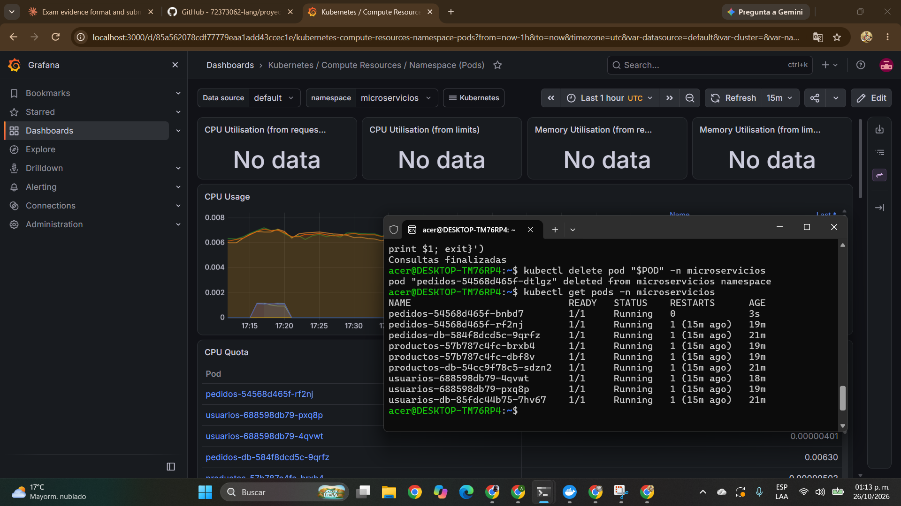

<!-- Evidencias del ultimo labo semana 11 -->

# Evidencias del ultimo labo semana 11

Captura de Grafana (dashboard Kubernetes / Compute Resources / Namespace (Pods), namespace microservicios) con la terminal de WSL mostrando los pods en ejecución.

## Acceso a Grafana

- URL: http://localhost:3000 (con `kubectl port-forward -n monitoring svc/monitoring-grafana 3000:80`)
- Usuario: `admin`
- Contraseña: `0T0xmPY5xCbqYwFbmWz7aqLa8Qdknq8xFwo2ZEol`
